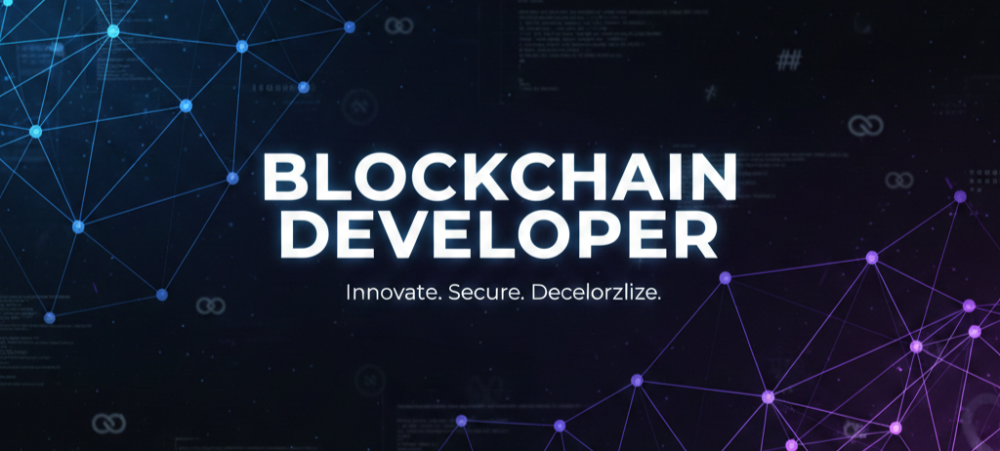

<!-- ============ HEADER ============ -->
<p align="center">
  
</p>

<p align="center">
  <a href="https://github.com/Arun-2010">
    
  </a>
</p>

<p align="center">
  
  <a href="mailto:arunbandari15@gmail.com"></a>
  <a href="https://linkedin.com/in/arun-bandari"></a>
</p>

---

<!-- ============ ABOUT ============ -->
<table>
<tr>
<td width="55%" valign="top">

### ⚡ `whoami`

```python
class Arun:
    roles = [
        "🤖 AI Engineer",          # priority #1
        "💻 Full Stack Developer",  # priority #2
        "⛓️ Blockchain Developer",  # priority #3
    ]
    building  = ["LLM apps", "RAG pipelines", "AI agents"]
    stack     = ["Python", "TypeScript", "Next.js", "Rust"]
    contact   = "arunbandari15@gmail.com"

    def motto(self):
        return "Train it. Ship it. Put it on-chain."
```

</td>
<td width="45%" valign="top" align="center">



</td>
</tr>
</table>

---

<!-- ============ SKILLS ============ -->
## 🛠️ Tech Arsenal

<table align="center">
<tr>
  <td align="center"><b>🤖 AI / Machine Learning</b></td>
</tr>
<tr>
  <td align="center">
    <br/><br/>
    
    
    
  </td>
</tr>
<tr>
  <td align="center"><b>💻 Full Stack</b></td>
</tr>
<tr>
  <td align="center"></td>
</tr>
<tr>
  <td align="center"><b>🗄️ Data & Infra</b></td>
</tr>
<tr>
  <td align="center"></td>
</tr>
<tr>
  <td align="center"><b>⛓️ Blockchain</b></td>
</tr>
<tr>
  <td align="center">
    <br/><br/>
    
  </td>
</tr>
</table>

<details>
<summary>🪙 <b>Solana wallet</b></summary>

```
BuDSwGWQfEaLLa7PQP7UsAL89pG52LKJLvapKHwrLKWg
```

</details>

---

<!-- ============ STATS ============ -->
## 📊 GitHub Stats

<p align="center">
  
  
</p>

<p align="center">
  
</p>

<p align="center">
  
</p>

---

<!-- ============ FOOTER ============ -->
<p align="center">
  <code>* *  o o  ^ ^  - -  x x</code><br/>
  <code>\_/  \_/  ___  \_/  ___</code><br/>
  <sub>moods of a dev waiting for the model to finish training</sub>
</p>

<p align="center">
  
</p>
